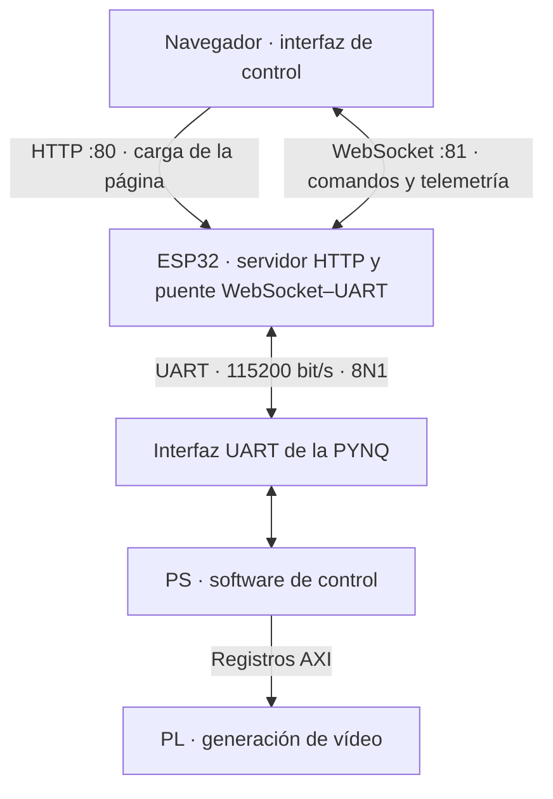

# IoT Tools · Interfaz web y puente UART

**TFG · Configuración remota de huellas sobre PYNQ-Z1**  
Firmware: [`webSocketTFG.ino`](webSocketTFG.ino) · Plataforma: ESP32 · Transporte: Wi-Fi / WebSocket / UART

## Descripción

Este módulo proporciona la interfaz de usuario para configurar los parámetros de representación de las huellas del proyecto. El ESP32 aloja una página web, recibe las acciones del usuario mediante WebSocket y las traduce a comandos de texto enviados por UART hacia la PYNQ-Z1. En sentido inverso, recibe líneas procedentes de la PYNQ y las publica en el navegador como telemetría.

El navegador permite seleccionar el sprite, solicitar un fondo y ajustar velocidad, cadera y separación horizontal entre huellas. La interfaz está integrada en el propio firmware y se sirve desde el ESP32; no requiere un servidor web externo ni descargar recursos desde una CDN.

La generación de vídeo se realiza en la lógica programable de la PYNQ. El ESP32 se ocupa de la conectividad y de la interacción con el usuario, mientras que el software del sistema de procesamiento interpreta los comandos y actualiza la configuración del hardware mediante AXI.

> **Alcance documental.** Este README describe la versión final de `webSocketTFG.ino` facilitada para el cierre de la base funcional `v0.1.0`. El archivo no incorpora una constante propia de versión. Las opciones disponibles en la interfaz y los comandos transmitidos se distinguen de su efecto visual, que depende del software y del overlay cargados en la PYNQ.

## Contenido

- [Arquitectura](#arquitectura)
- [Funciones disponibles](#funciones-disponibles)
- [Dependencias y compilación](#dependencias-y-compilación)
- [Configuración y conexiones](#configuración-y-conexiones)
- [Puesta en marcha](#puesta-en-marcha)
- [Protocolo de comunicación](#protocolo-de-comunicación)
- [Interfaz y comportamiento](#interfaz-y-comportamiento)
- [Organización del firmware](#organización-del-firmware)
- [Diagnóstico y comprobación](#diagnóstico-y-comprobación)
- [Límites de la implementación](#límites-de-la-implementación)

## Arquitectura



La ruta de configuración tiene cuatro etapas:

1. El navegador envía una orden breve, por ejemplo `gap:86`.
2. El ESP32 reconoce la orden, procesa el valor y transmite `SETGAP::86` seguido de un salto de línea por `Serial1`.
3. El software de la PYNQ interpreta la línea y actualiza los parámetros correspondientes.
4. El hardware de representación utiliza la configuración recibida para generar la imagen.

La ruta de retorno parte de las líneas UART emitidas por la PYNQ. El ESP32 añade el prefijo `UART:` y las difunde a los clientes WebSocket conectados, con el filtrado temporal descrito más adelante.

## Funciones disponibles

| Función | Implementación en el ESP32 |
| --- | --- |
| Interfaz web integrada | HTML, CSS y JavaScript almacenados en `INDEX_HTML`, declarado con `PROGMEM`. |
| Acceso a red | Selección en compilación entre estación Wi-Fi (STA) y punto de acceso (AP). |
| Control de parámetros | Traducción de órdenes WebSocket a comandos UART para velocidad, cadera, gap, sprite y fondo. |
| Selección de sprite | Botones para los identificadores `0` a `15`. |
| Retorno UART | Recepción por líneas y difusión a todos los clientes WebSocket. |
| Reconexión del navegador | Nuevo intento de conexión WebSocket 1,5 s después del cierre de la conexión. |
| Supervisión de conexión | Intercambio de texto `ping`/`pong` y heartbeat del servidor WebSocket. |
| Diagnóstico local | Mensajes de arranque, motivo de reinicio, dirección IP, eventos WebSocket y memoria libre. |
| Señales auxiliares | Copia del nivel de `DEBUG_IN` a `DEBUG_OUT` en cada ejecución de `loop()`. |

## Dependencias y compilación

El sketch está desarrollado para el entorno Arduino sobre ESP32. Utiliza las siguientes cabeceras:

| Cabecera | Función |
| --- | --- |
| `WiFi.h` | Configuración Wi-Fi en modo STA o AP. |
| `WebServer.h` | Servidor HTTP que entrega la página de control. |
| `WebSocketsServer.h` | Servidor WebSocket, eventos de cliente y heartbeat. |
| `esp_system.h` | Consulta del motivo de reinicio del ESP32. |

Para compilar se necesita el soporte Arduino para ESP32 y una biblioteca que proporcione `WebSocketsServer.h`, correspondiente a la biblioteca **WebSockets de Markus Sattler / Links2004**. El archivo no fija versiones del core ni de las bibliotecas; para reproducir la entrega conviene registrar las utilizadas en la compilación validada.

En Arduino IDE, el sketch debe estar en una carpeta denominada `webSocketTFG`, con el archivo `webSocketTFG.ino` dentro. Seleccionar la placa real y el puerto de programación, revisar la configuración de red y los GPIO y, después, compilar y cargar.

## Configuración y conexiones

### Parámetros principales

| Parámetro | Valor en el firmware recibido | Descripción |
| --- | --- | --- |
| `MODO_AP` | `0` | `0`: estación STA; `1`: punto de acceso AP. |
| `UART_BR` | `115200` | Velocidad del enlace con la PYNQ, en bit/s. |
| Configuración UART | `SERIAL_8N1` | Ocho bits de datos, sin paridad y un bit de parada. |
| HTTP | Puerto `80` | Entrega de la página de control. |
| WebSocket | Puerto `81` | Canal bidireccional de comandos y telemetría. |
| `APchannel` | `6` | Canal empleado únicamente en modo AP. |
| Clientes Wi-Fi en AP | `4` | Límite solicitado mediante `WiFi.softAP()`. No equivale al límite de sesiones WebSocket. |
| `DEBUG_IN` / `DEBUG_OUT` | GPIO `25` / `26` | Entrada y salida auxiliares; comprobar su disponibilidad en la placa utilizada. |

Las credenciales STA se configuran mediante `ssid` y `password`; las de AP mediante `APssid` y `APpassword`. No se reproducen contraseñas en esta documentación. **Antes de publicar el sketch en GitHub, sustituir las credenciales reales por valores de ejemplo.**

### Asignación UART por placa

La selección se realiza mediante macros del entorno de compilación:

| Macro detectada | `UART_RX` | `UART_TX` | Identificación interna |
| --- | --- | --- | --- |
| `ARDUINO_ESP32S3_DEV` | GPIO `16` | GPIO `17` | `PLACA_1` |
| `ARDUINO_ESP32_DEV` | GPIO `18` | GPIO `19` | `PLACA_2` |
| Ninguna de las anteriores | GPIO `16` | GPIO `17` | `PLACA_DESCONOCIDA`, con aviso de compilación. |

Esta tabla describe las ramas del código; la disponibilidad física de los GPIO y la definición de las macros deben comprobarse con el modelo concreto de placa. La selección de UART no modifica los GPIO de depuración `25` y `26`.

### Cableado con la PYNQ

| ESP32 | Conexión en la PYNQ |
| --- | --- |
| `UART_TX` | Entrada RX de la interfaz UART configurada en el diseño. |
| `UART_RX` | Salida TX de esa interfaz UART. |
| GND | Masa común. |

El enlace utiliza señales lógicas de 3,3 V. Los pines físicos de la PYNQ dependen de los constraints y del diseño cargado; no están definidos en este sketch. La consola `Serial` de diagnóstico y el enlace `Serial1` con la PYNQ son canales distintos, aunque ambos se inicializan a 115200 bit/s.

### Modos Wi-Fi

**STA — configuración actual.** El ESP32 se conecta a la red indicada en el código. La dirección IP se muestra en la consola. Si la conexión inicial no se establece en aproximadamente 20 s, se reinicia el intento. `setupWiFi()` espera hasta conseguir conexión, por lo que los servidores se inician después de este paso.

**AP — alternativa autónoma.** Con `MODO_AP = 1`, el ESP32 crea su propia red. El usuario conecta su dispositivo a esa red y utiliza la IP mostrada en la consola. El firmware solicita canal 6, SSID visible y un máximo de cuatro estaciones. No implementa un portal cautivo ni un servidor DNS.

En ambos modos se desactiva el ahorro de energía Wi-Fi mediante `WiFi.setSleep(false)`.

## Puesta en marcha

1. Preparar la PYNQ con el overlay y el software de control compatibles, y conectar la UART con TX/RX cruzados y masa común.
2. Revisar la placa seleccionada, los GPIO y las credenciales del sketch. Compilar y programar el ESP32.
3. Abrir la consola serie a **115200 bit/s**. Comprobar el modo de red, la dirección IP y los mensajes de inicio de HTTP y WebSocket.
4. Conectar el ordenador o dispositivo de control a la misma red que el ESP32; en modo AP, conectarlo a la red creada por este.
5. Abrir `http://<IP_DEL_ESP32>/`. La página establece automáticamente una conexión con `ws://<IP_DEL_ESP32>:81/`.
6. Verificar el mensaje de conexión. Activar el panel manual si se desean ajustar velocidad, cadera y gap.
7. Aplicar un parámetro y comprobar tanto el retorno de la PYNQ como el resultado visual. Un mensaje local del ESP32, por sí solo, no verifica toda la cadena.

Los valores iniciales del panel son velocidad `5`, cadera `40` y gap `80`. Son valores de la interfaz web; la página no consulta el estado de la PYNQ al abrirse.

## Protocolo de comunicación

### Navegador → ESP32 → PYNQ

Los mensajes WebSocket son tramas de texto. El ESP32 elimina espacios al principio y al final del mensaje y de los valores extraídos. Las órdenes reconocidas distinguen mayúsculas y minúsculas. Cada comando UART generado termina con el carácter **LF** (`\n`).

| Mensaje WebSocket | Comando UART | Procesamiento en el ESP32 |
| --- | --- | --- |
| `vel:<n>` | `SETSPEED::<n>\n` | Limita el valor al intervalo `0…10`. |
| `cadera:<n>` | `SETCADERA::<n>\n` | Limita el valor al intervalo `−240…240`. |
| `gap:<n>` | `SETGAP::<n>\n` | Limita el valor al intervalo `0…1023`. |
| `sprite:<n>` | `SETSPRITE::<n>\n` | Exige una cadena de dígitos y un valor entre `0` y `15`. |
| `fondo1` | `SETBG::0\n` | Solicita el identificador de fondo `0`. |
| `fondo2` | `SETBG::1\n` | Solicita el identificador de fondo `1`. |
| `modo: manual` | No transmite UART. | Devuelve un mensaje de modo manual. |
| `modo: auto` | No transmite UART. | Devuelve un mensaje de modo automático. |
| `ping` | No transmite UART. | Responde `pong` al cliente solicitante. |

El significado geométrico de cadera, la conversión de velocidad a periodo de movimiento y la aplicación de los parámetros corresponden al software de control de la PYNQ.

> **Gap compatible con la base validada.** Aunque la web y el puente admiten `0…1023`, el software de control asociado a las huellas de 16 píxeles establece un mínimo de `16`. Para esa configuración se debe utilizar **`16…1023`**. La aceptación por el ESP32 de un valor inferior no implica que la PYNQ lo acepte.

Los campos vacíos se rechazan. Para velocidad, gap y cadera se utiliza `String::toInt()` sin una validación léxica completa: una entrada textual mal formada puede convertirse en cero o en un prefijo numérico antes de aplicar los límites. El identificador de sprite sí dispone de comprobación explícita de dígitos y rango.

### Respuestas del ESP32

Las respuestas locales se envían al cliente que emitió la orden. Por ejemplo:

```text
Navegador → ESP32: gap:86
ESP32 → PYNQ:     SETGAP::86\n
ESP32 → navegador: OK: gap=86
```

En este ejemplo, `\n` representa el salto de línea transmitido. La respuesta `OK: gap=86` se genera inmediatamente después de escribir el comando en `Serial1`: **confirma el procesamiento y envío local, no una confirmación de ejecución recibida de la PYNQ**.

Las órdenes desconocidas producen `Error: comando no reconocido`. Las tramas binarias se registran en la consola, pero no se traducen a comandos UART.

### PYNQ → ESP32 → navegador

La función `readUARTNonBlocking()` procesa los bytes disponibles en `Serial1`:

1. Acumula caracteres hasta recibir LF y omite los caracteres CR.
2. Recorta los extremos de la línea y descarta las líneas vacías.
3. Si han transcurrido al menos 5 ms desde la última difusión, publica `UART:<línea>` a todos los clientes WebSocket.
4. Limpia el acumulador para procesar la siguiente línea.

Ejemplo de formato, con contenido de retorno ilustrativo:

```text
UART recibida:        <respuesta de la PYNQ>\n
WebSocket difundido:  UART:<respuesta de la PYNQ>
```

El contenido de la respuesta depende del software de la PYNQ. Las líneas que llegan dentro de la ventana de 5 ms se descartan; no se encolan para enviarlas después. El acumulador admite hasta 256 caracteres y se vacía con un aviso si se intenta superar esa longitud. Tras ese vaciado puede comenzar a acumularse el resto de la misma línea: no hay resincronización explícita hasta el siguiente LF.

## Interfaz y comportamiento

### Controles

- **Fondo:** solicita uno de los dos identificadores disponibles en el protocolo.
- **Sprite:** envía la selección `0…15`; la apariencia depende de las imágenes almacenadas en la ROM del hardware.
- **Limpiar LOGS:** borra el registro del navegador y mantiene una indicación del estado WebSocket. No modifica la PYNQ.
- **Selector de modo:** muestra u oculta el panel manual.
- **Control manual:** combina deslizadores, campos numéricos, botones de incremento/decremento y aplicación individual o conjunta.

El deslizador actualiza el valor local mientras se mueve y envía la orden al finalizar el cambio. El campo numérico envía al cambiar o pulsar Intro. Los botones `+` y `−` modifican el valor local; el botón **Aplicar** permite transmitirlo.

**Aplicar todo** envía velocidad, cadera y gap, en ese orden, como tres mensajes independientes. No constituye una transacción atómica. Al activar el modo manual también se envían esos tres valores.

### Alcance del selector manual/automático

En este firmware, los mensajes `modo: manual` y `modo: auto` solo generan diagnóstico y una respuesta al navegador. No envían órdenes de arranque, parada o cambio de algoritmo a la PYNQ. Por tanto, el selector controla la presentación del panel; no demuestra un cambio de modo de la simulación remota.

### Telemetría y estado mostrado

Las líneas que comienzan por `UART:` actualizan el cuadro **Telemetría UART**, sustituyendo su contenido anterior. El resto de mensajes de texto se añade al registro, excepto `pong`, que se trata silenciosamente.

Los cuadros de cadera y separación reflejan los valores seleccionados localmente. No se reconstruyen a partir de la telemetría ni constituyen una lectura de registros del hardware. Del mismo modo, las indicaciones «Valores enviados» o «Gap=…» no son confirmaciones remotas.

### Mantenimiento de conexión

| Mecanismo | Configuración | Alcance |
| --- | --- | --- |
| Ping de aplicación | El navegador envía el texto `ping` cada 5 s y el ESP32 responde `pong`. | Intercambio de texto; el JavaScript no implementa un timeout propio por ausencia de `pong`. |
| Heartbeat WebSocket | `enableHeartbeat(15000, 3000, 2)`. | Supervisión mediante la biblioteca: intervalo de 15 s, timeout de 3 s y umbral de dos fallos. |
| Reconexión del navegador | Intento 1,5 s después de `onclose`. | Recuperación de la sesión WebSocket. |

Los comandos emitidos sin conexión no se encolan. Tampoco se reenvían automáticamente los parámetros tras reconectar.

## Organización del firmware

| Elemento | Responsabilidad |
| --- | --- |
| `INDEX_HTML` | Documento completo de la interfaz, estilos y lógica JavaScript. |
| `sendRoot()` | Entrega de la página principal mediante HTTP. |
| `handleNotFound()` | Redirección HTTP `302` hacia `/` para rutas desconocidas. |
| `setupWiFi()` | Inicialización de AP o conexión inicial en STA. |
| `processIncomingCommand()` | Reconocimiento, procesamiento y traducción de órdenes. |
| `onWebSocketEvent()` | Atención de conexiones, desconexiones y tramas WebSocket. |
| `sendWsText()` | Envío de una respuesta a un cliente concreto. |
| `readUARTNonBlocking()` | Recepción por líneas y publicación de telemetría. |
| `logResetReason()` / `printHeap()` | Información de diagnóstico de arranque. |
| `setup()` | Inicialización de consola, UART, GPIO, Wi-Fi y servidores. |
| `loop()` | Servicio HTTP, servicio WebSocket, recepción UART y copia del GPIO auxiliar. |

El bucle principal atiende estos servicios de forma cooperativa. La recepción UART evita esperar deliberadamente una línea completa: procesa los bytes disponibles. No obstante, su `while (Serial1.available())` no establece un presupuesto máximo por iteración; un flujo continuo puede retrasar la atención de otros servicios.

## Diagnóstico y comprobación

### Comprobación funcional de la cadena

| Prueba | Resultado esperado |
| --- | --- |
| Arranque | Consola con motivo de reinicio, placa identificada, IP y servidores iniciados. |
| Acceso HTTP | Página de control disponible en la IP del ESP32. |
| Apertura WebSocket | Mensaje de conexión en el navegador y evento de cliente en la consola. |
| Orden `gap:86` | Transmisión de `SETGAP::86` seguida de LF; respuesta local `OK: gap=86`. |
| Retorno UART aislado | Una línea recibida fuera de la ventana de filtrado aparece en Telemetría UART. |
| Orden `sprite:16` | Rechazo por identificador fuera de rango, sin generar la orden de selección. |
| Orden desconocida | Respuesta `Error: comando no reconocido`. |
| Desconexión y recuperación | Tras cerrarse el WebSocket, el navegador intenta reconectar. |
| Integración con PYNQ | El parámetro válido se aplica y produce el comportamiento visual previsto. |

Esta tabla constituye una guía de comprobación, no un registro de pruebas ejecutadas para cada caso. La base del proyecto ha sido validada en placa por su autor para el pintado y el movimiento suave de las huellas con firmware, software y hardware integrados.

### Resolución de incidencias

| Síntoma | Comprobaciones |
| --- | --- |
| No aparece la página | Revisar alimentación, conexión Wi-Fi, IP de consola y pertenencia a la misma red. En STA, comprobar que se completó la conexión inicial. |
| La página carga, pero WebSocket falla | Comprobar accesibilidad del puerto `81` y que se está utilizando la página por HTTP. |
| Se recibe «OK», pero no cambia la imagen | Revisar TX/RX, masa, 115200/8N1, software receptor y overlay. El «OK» es local al ESP32. |
| No aparece telemetría | Verificar TX de la PYNQ hacia RX del ESP32 y que las líneas terminen en LF. El filtrado puede descartar respuestas próximas entre sí. |
| El gap no se aplica | Para la base con sprites de 16 píxeles, utilizar un valor de al menos `16` y revisar la respuesta de la PYNQ. |
| El selector de modo no detiene el movimiento | Comportamiento previsto: no transmite una orden UART de parada. |
| Se notifica exceso de longitud UART | Revisar la longitud de las líneas, el terminador LF y la configuración del enlace. |

## Límites de la implementación

- **Confirmaciones locales:** no hay identificadores de petición, correlación de respuestas, reintento de comandos ni confirmación de aplicación extremo a extremo.
- **Estado por navegador:** cada cliente mantiene sus propios controles. La telemetría se difunde a todos, pero no existe arbitraje entre usuarios ni sincronización de los valores seleccionados.
- **Recepción de telemetría con pérdidas:** el filtrado de 5 ms descarta líneas y el navegador muestra únicamente la última línea UART recibida. No es un registro exhaustivo de la comunicación.
- **Modo y fondo:** el selector de modo no controla la simulación remota. Las órdenes de fondo sí se transmiten, pero su efecto visual depende de la implementación del overlay; no se garantiza por la existencia del botón.
- **Red local:** el firmware sirve HTTP y WebSocket sin TLS y no implementa autenticación de aplicación. Aunque el JavaScript contempla el prefijo `wss://` para una página HTTPS, este sketch no configura un servidor WebSocket seguro.
- **Reproducción de la entrega:** la compatibilidad completa requiere conservar conjuntamente las versiones del firmware, software de control y overlay. El protocolo no incluye negociación automática de versiones.

Las ampliaciones futuras pueden abordar la consulta del estado remoto, confirmaciones correlacionadas, armonización del rango de gap y nuevos controles gráficos, manteniendo esta versión como referencia funcional del diseño base.
